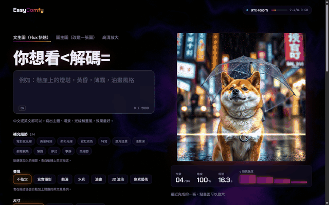
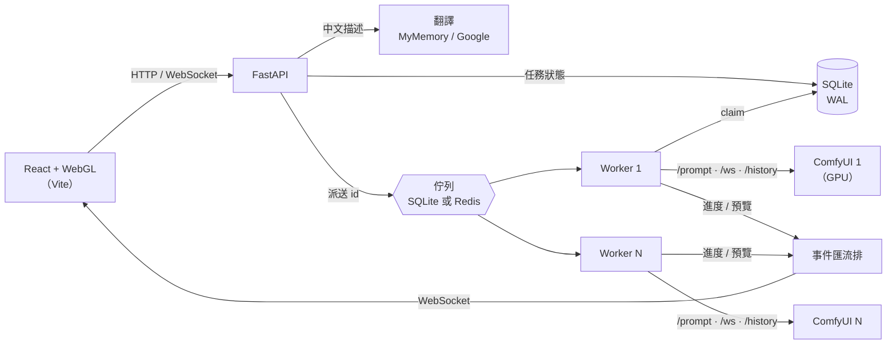

# EasyComfy

讓新手不用碰節點圖也能使用 ComfyUI：選一個模板、用中文寫一句描述、點幾個細節，按下「開始生成」就好。
後端負責翻譯、排隊、派送到 ComfyUI、追蹤進度和保存結果；前端用 WebGL 把擴散模型「從雜訊收斂成圖片」的過程即時畫出來。



| | |
|---|---|
| 端對端生成（RTX 4060 Ti 8GB、Flux schnell Q4） | 約 17–20 秒／張 |
| 多台 ComfyUI 擴充 | 1 → 2 → 4 台吞吐量 ×1.97、×3.91（[壓測](docs/BENCHMARK.md)） |
| 排程成本 | 約 20ms／張；開啟 SQLite WAL 前是它的 3 倍 |
| 測試 | 後端 67 個 pytest，GitHub Actions 每次推送執行 |

## 功能

**給新手**
- **白話表單**：每個 ComfyUI 工作流配一份 YAML，把節點參數變成「尺寸」「細節程度」「改變程度」這類選項
- **中文描述自動翻譯**：Flux 的文字編碼器幾乎只看得懂英文，中文會先翻成英文再送出；紀錄同時保留原文和送出的英文，翻譯失敗時明確告知，不會把中文直接送進模型
- **補充細節與畫風**：點選光線、鏡頭、氛圍等細節（最多 4 個）與 7 種畫風，自動擴寫成完整的英文提示詞
- **三種模板**：文生圖、圖生圖（拖放、點擊或 Ctrl+V 貼上原圖）、Real-ESRGAN 高清放大；生成好的圖可以直接接著放大或拿去圖生圖
- **批次、插隊與管理**：一次 1–4 張（種子連號可重現）、排隊中的任務可以移到最前面、刪除單張或一鍵清除失敗紀錄（都要按兩次確認）

**排程與可靠性**
- **持久化佇列**：任務存在 SQLite，服務重啟後還在；佇列可換成 Redis，讓 worker 分散到不同行程
- **多台 ComfyUI**：每台一個 worker，以資料庫條件更新原子地搶任務；圖生圖的原圖會自動複製到執行的那一台
- **送單前檢查**：比對 ComfyUI `/object_info`，缺模型或缺節點時立刻告知，不必等排到才失敗
- **斷線重連與事件看門狗**：WebSocket 中斷會退避重試；30 秒沒有任何事件就改用 HTTP 查詢狀態，完成事件遺失也不會卡住

**介面**
- **即時去雜訊預覽**：解析 ComfyUI 的二進位預覽影格，用 WebGL shader 呈現從熱圖雜訊逐塊溶解成畫面的過程
- **取樣遙測**：步數、經過時間、σ 雜訊強度，以及從 ComfyUI 讀取的即時 VRAM 用量
- **WebGL 特效**：domain-warped fbm 雜訊場背景（限制 30fps 以免和 ComfyUI 搶顯示卡）、卡片 3D 傾斜反光、View Transitions 縮圖變形；支援「減少動態」設定與無 WebGL 的退回

## 架構



一個任務的生命週期：

1. 前端送出模板 id 和欄位值；後端驗證、翻譯中文、套進 workflow，並向 ComfyUI 確認模型都在
2. 寫入 SQLite（`queued`），把 id 放進佇列
3. 空閒的 worker 取出 id，用 `UPDATE … WHERE status = 'queued'` 原子地搶下任務
4. 送到 ComfyUI，透過 WebSocket 接收進度與預覽影格，即時轉推給所有前端
5. 完成後從 `/history` 找出輸出、下載存檔，標記 `succeeded`

規劃與進度：[docs/PLAN.md](docs/PLAN.md)

## 工程紀錄：排程成本與可靠性設計取捨

- **SQLite journal 模式讓排程成本多了三倍**：壓測時發現排程成本（任務從進佇列到開始執行之間，扣掉模型生成時間的額外開銷）異常地高，而且台數越多越嚴重——4 台 ComfyUI 時高達 56.4%。
  > 情況說明：先排除是壓測腳本自己造成干擾（原本每 10ms 查一次所有任務狀態會和 worker 搶資料庫），改成每 50ms 一次 `count` 查詢後數字幾乎沒變，確認不是量測問題。推測是一個任務從建立到完成要 commit 4–5 次（建立、搶單、開始、進度、完成），SQLite 預設的 rollback journal 每次 commit 都要 fsync，在 Windows 上約 10ms，台數越多、同時寫入的 worker 越多，彼此等鎖的時間也越長。改成 `journal_mode=WAL` + `synchronous=NORMAL`（[`backend/app/db.py`](backend/app/db.py)）後，WAL 下寫入只追加到記錄檔、讀取不會被寫入擋住，4 台時排程成本從 56.4% 降到 12.5%，驗證了推測。完整數據與方法見 [docs/BENCHMARK.md](docs/BENCHMARK.md)。
- **多台 ComfyUI 擴充：原子搶單，不用分散式鎖**：每台 ComfyUI 配一個 worker，全部從同一張 SQLite 任務表搶任務，吞吐量幾乎和台數成正比（1 → 2 → 4 台：×1.97、×3.91）。
  > 情況說明：多個 worker 同時盯著同一批 `queued` 任務，如果「查詢待辦任務」和「標記成 running」是兩步，就會有兩台同時搶到同一筆的競態。解法是把搶單寫成一條原子的 `UPDATE job SET status = 'running' WHERE id = ? AND status = 'queued'`（[`Database.claim`](backend/app/db.py)）：SQLite 的寫入本身就序列化，誰先 commit 誰就搶到，後到的 `UPDATE` 影響 0 筆就自然放棄，不需要額外的鎖或分散式協調。圖生圖上傳的原圖只存在第一台，其他台搶到任務時才按需把原圖複製過去（[`Worker._sync_inputs`](backend/app/worker.py)），避免每張上傳圖都要廣播到所有 ComfyUI。
- **斷線重連與事件看門狗：寧可多問一次 ComfyUI，也不要卡死任務**：WebSocket 進度推播中斷時用退避重試重連，30 秒沒收到任何事件就改成用 HTTP 問 ComfyUI 任務狀態。
  > 情況說明：長任務跑到一半 WebSocket 斷線是正常狀況（ComfyUI 重啟、網路抖動），重連後不能直接假設任務還在跑——必須先問 `/history` 確認任務是「還在執行」「已經做完」「已經失敗」還是「ComfyUI 重啟後整個遺失」（[`Worker._finished_while_away`](backend/app/worker.py)），否則重連後會錯過完成事件、任務永遠卡在 running。實測在 Docker Compose 第一次啟動時真的遇過完成事件遺失（事件在網路上掉了，不是 ComfyUI 沒送），所以額外加了「閒置看門狗」：事件迴圈 30 秒沒收到任何東西就主動用 HTTP 查一次狀態，查到完成就直接結束，不用等下一個事件（[`Worker._listen`](backend/app/worker.py)）。重連次數上限 5 次、延遲用 `2^失敗次數`（上限 10 秒）的指數退避，避免 ComfyUI 短暫不可用時瘋狂重試。

## 本機執行

需要：Python 3.11+、Node.js 20+，以及已啟動的 ComfyUI（預設 `http://127.0.0.1:8188`）。
內建的 Flux schnell 模板需要 [ComfyUI-GGUF](https://github.com/city96/ComfyUI-GGUF) 節點和以下模型：

| 類型 | 檔案 |
|---|---|
| diffusion_models | `flux1-schnell-Q4_0.gguf` |
| clip | `t5xxl_fp8_e4m3fn.safetensors`、`clip_l.safetensors` |
| vae | `ae.safetensors` |
| upscale_models（高清放大） | `RealESRGAN_x4plus.pth` |

```bash
# 後端
cd backend
python -m venv .venv
.venv\Scripts\activate          # macOS/Linux：source .venv/bin/activate
pip install -r requirements.txt
uvicorn app.main:app --reload --port 8000

# 前端（另開一個終端機）
cd frontend
npm install
npm run dev
```

打開 http://localhost:5173 即可使用，API 文件在 http://localhost:8000/docs 。

ComfyUI 不在預設位址時，在 `backend/.env` 設定：

```
EASYCOMFY_COMFY_URL=http://127.0.0.1:8188
```

### 中文翻譯

預設使用免費的 [MyMemory](https://mymemory.translated.net/doc/spec.php) 翻譯 API，不需要註冊（匿名每天約 5,000 字元）。也可以在 `backend/.env` 改用其他設定：

```
# 改用 Google Cloud Translation（需要已啟用帳單的 Google Cloud 專案）
EASYCOMFY_GOOGLE_API_KEY=你的金鑰

# 或者提供 email 給 MyMemory，把每日額度提高到約 50,000 字元
EASYCOMFY_MYMEMORY_EMAIL=you@example.com
```

同一句話的翻譯會快取在記憶體裡，重新生成不會重複耗用額度。

## 新增模板

1. 在 ComfyUI 組好流程，選單 **Workflow → Export (API)** 匯出 JSON。
2. 建立 `backend/templates/<模板id>/`，放入 `workflow_api.json` 和 `template.yaml`。
3. 在 `template.yaml` 用 `節點ID.輸入名稱` 指定每個欄位要寫到哪裡，可參考 `flux_schnell_t2i`。
4. 重啟後端，跑 `pytest` 確認模板能正確載入。

## 多台 ComfyUI、Redis 佇列

在 `backend/.env` 設定：

```
# 逗號分隔，第一台負責送單前檢查與接收上傳的圖片
EASYCOMFY_COMFY_URLS=http://127.0.0.1:8188,http://192.168.1.20:8188

# 改用 Redis 佇列
EASYCOMFY_QUEUE_BACKEND=redis
EASYCOMFY_REDIS_URL=redis://localhost:6379/0
```

## Docker Compose

```bash
docker compose up --build
```

打開 http://localhost:8080 。會啟動 Redis、後端與 nginx 前端；ComfyUI 需要直接使用顯示卡，所以仍在本機執行，
容器透過 `host.docker.internal:8188` 連線（可用環境變數 `COMFY_URL` 改）。

## 測試

```bash
cd backend
pip install -r requirements-dev.txt
pytest
```
